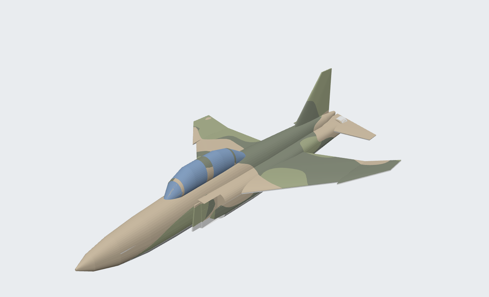

# RF-4C Phantom II, 10th TRW, RAF Alconbury, 1972: 1:72 multi-color kit



A 1:72 RF-4C (266 mm long, 162 mm span) for a Bambu Lab P1S + AMS. It's painted in the
Southeast Asia scheme the 10th Tactical Reconnaissance Wing's Phantoms wore at Alconbury in the
early '70s: tan and two greens over a light-gray belly. Every piece prints flat with
**no supports**, and the colors are printed in, not painted.

Open `output/viewer.html` in a browser to spin the assembled model around.

> This is a simplified, recognizable desk model built from published dimensions. It is not a
> scale-accurate master. The camouflage is a procedural pattern in the SEA colors, not the
> official T.O. 1-1-4 pattern drawing. There are no national insignia or tail codes; aftermarket
> 1:72 decals for 10th TRW RF-4Cs are the way to add those.

## The kit

| Plate | File | Pieces | Colors |
|---|---|---|---|
| 1 | `plate1_upper_multicolor.3mf` | Upper fuselage + whole inner wing + fin + canopy | all 5 |
| 2 | `plate2_lower_and_panels.3mf` | Lower fuselage, 2 outer wing panels, 2 stabilators | 4 (no canopy) |
| 3 | `plate3_stand.3mf` | Display stand: oval base, inlaid legend, post | 3 |

Individual STLs for every color part are in `output/stl/`.

### Assembly
1. **Pins:** cut three 6 mm pieces of 1.75 mm filament. Push them into the holes on the
   fuselage joint face, then glue the upper and lower halves together (CA or plastic cement).
2. **Outer wing panels:** glue them to the inner wing's fold line, tilted up 12°. The panel's root
   face is already angled, so a flat butt joint sets the dihedral.
3. **Stabilators:** the root faces are shaped to the tail cone. Glue them on drooping down 23°.
4. **Stand:** the post plugs into the socket in the belly, under the middle of the wing.

## Filament / AMS slots

The kit uses five color names. Assign them to your AMS slots in Bambu Studio:

| Part name | Real color (FS595) | **With what you have now** | **Authentic SEA** |
|---|---|---|---|
| `camo_tan` | Tan 30219 | Gray | Tan (e.g. a matte desert tan) |
| `camo_green` | Green 34102 | Green | Medium olive green |
| `camo_darkgreen` | Dark green 34079 | Green | Dark green |
| `underside_lightgray` | Light gray 36622 | White | Light gray |
| `canopy` | glass | Blue | Gray or dark green (only 4 AMS slots) |
| `stand_base` / `stand_text` / `stand_post` | n/a | Blue / White / Gray | same |

With only gray, white, green and blue, the kit prints as a gray-and-green two-tone with a white
belly and blue canopy. That looks good, but it isn't the 1972 scheme. For the real look, add a
**tan** and a **dark green** spool. Matte PLA looks best on military models. Then load:
slot 1 tan, slot 2 green, slot 3 dark green, slot 4 light gray (your gray). The canopy shares a
slot, so pick dark green or gray for it.

## Slicing in Bambu Studio

1. Open a plate's 3MF. Each piece loads as one object made of named color parts. In the Objects
   list, expand each object and set every part's filament as in the table above.
2. **Don't scale individual parts.** To change the scale, rebuild with `--scale` (see below).
3. Settings that work:
   - 0.12 mm or 0.16 mm layer height (the fine detail is worth it at 1:72)
   - 0.4 mm nozzle, 2 walls, 15% infill
   - **Supports: off** (nothing needs them)
   - **Prime tower on**, and **flush into objects' infill** on to cut down on purge waste
   - Plate 1 is placed diagonally to fit the 256 mm bed (it is 266 mm long). Leave it where it is.
     If you press Arrange, allow rotation.
4. Plate 1 has the most color changes, so check its time and filament estimate first. Plates 2 and 3 have far fewer.

## Re-generating / customizing

```bash
pip install numpy scipy pillow manifold3d scikit-image trimesh
python build_rf4c.py                  # rebuild output/ at 1:72
python build_rf4c.py --scale 100      # 1:100 (192 mm long, fits without diagonal placement)
python build_rf4c.py --seed 7         # a different camouflage pattern
python build_rf4c.py --demarcation 0.3   # camo comes further down the fuselage sides
python make_viewer.py                 # refresh output/viewer.html
NODE_PATH=$(npm root -g) node screenshots.js output/viewer.html output "preview_quarter=az=215&el=22&d=2.2"
```

The airframe is defined in `Phantom` in `build_rf4c.py` as fuselage stations, wing sections and
tail sections, all in full-size metres. Edit those to refine the shape.
