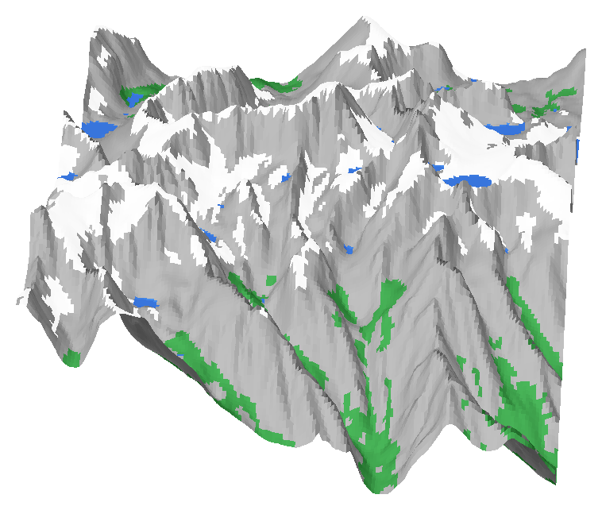

# Mt Whitney: 4-color exaggerated relief (Bambu Lab P1S + AMS)



A 200 × 158 mm terrain model of Mt Whitney (14,505 ft) and its cirques, built from real
USGS elevation data with **1.75× vertical exaggeration** (about 74 mm tall). It prints in four colors:

| AMS slot | Filament | What it is |
|---|---|---|
| 1 | **Gray** | Rock, plus the solid core and base |
| 2 | **White** | Snow: high ground on gentle slopes, lower on north faces, and mapped permanent ice |
| 3 | **Green** | Trees: below treeline (~3,380 m) on slopes under 34° |
| 4 | **Blue** | Lakes from the USGS hydrography map: Guitar, Hitchcock, Crabtree, Timberline, Wallace, Wales, Tulainyo, Arctic, Consultation, Mirror, Lone Pine, Boy Scout, Meysan and others |

The frame is about 10 × 8 km. It runs from the Crabtree Lakes and Guitar Lake in the west to
Whitney Portal and Lone Pine Lake in the east, and from Wallace and Tulainyo lakes in the north
to Meysan Lake in the south. Whitney's summit sits just left of center.

## Files (`output/`)

| File | Use |
|---|---|
| `whitney_relief.3mf` | One object made of 4 named parts. Open it in Bambu Studio. |
| `whitney_1_rock_gray.stl` … `whitney_4_water_blue.stl` | The same 4 parts as separate STLs (fallback) |
| `preview_*.png` | Quick renders |

The parts nest together. White, green and blue are 1.4 mm "skins" sitting in matching pockets
on top of the gray core, so the lower part of the print is gray only, with no color changes.
Every part is a closed mesh.

## Slicing in Bambu Studio

1. **Load:** open `whitney_relief.3mf`. To use the STLs instead, drag all four in at once. When
   Bambu Studio asks *"load these files as a single object with multiple parts?"*, answer **Yes**.
2. **Assign filaments:** in the Objects list, expand the object. Click each part's filament
   number and set rock to gray, snow to white, trees to green, and water to blue. The 3MF has
   color hints, but check each part anyway.
3. **Do not scale the parts separately.** Scale the whole object if you need to.
4. **Suggested settings:**
   - Profile: 0.20 mm Standard. For finer contour lines, use 0.16 mm (more layers, more swaps).
   - Wall loops: 2. Infill: 10–15% gyroid. Top shell layers: 5.
   - Prime tower: **on**.
   - **Flush into objects' infill: on** (Others tab or the part's settings). This puts much of
     the purge inside the mountain instead of into poop.
   - Flushing volumes: the gray→white flush needs to stay high or the snow turns dingy. Green and
     blue are more forgiving, so you can lower flushes into them.
   - Supports: **none** needed. Brim: optional.

### What to expect

Color swaps happen only on layers where more than one color shows. Most layers have just
two colors: gray + green down low, gray + white up high. Lakes add blue only at their own
water levels. Even so, this is a long print. Expect several hundred swaps, roughly a day or
more on a P1S, and a pile of purge waste. Look at Bambu Studio's estimate before you commit.
To reduce the time:

- `--exaggeration 1.4`: a shorter model with fewer layers and fewer swaps
- 0.24 mm layers
- `--width 150`: less area per layer. This saves time but not swaps.

## Re-generating / customizing

```bash
pip install numpy scipy pillow trimesh matplotlib
python build_relief.py                         # rebuild output/
python render_preview.py                       # refresh the preview images
```

Useful knobs:

| Flag | Default | Effect |
|---|---|---|
| `--width` | 200 | Model width in mm (the P1S bed is 256) |
| `--exaggeration` | 1.75 | Vertical exaggeration |
| `--snowline` | 3700 | Metres. Lower it for a deep-winter look, raise it for late summer |
| `--north-bonus` | 200 | How much lower snow reaches on north-facing slopes, in metres |
| `--max-snow-slope` | 36 | Steeper faces stay bare gray rock (like Whitney's east face) |
| `--treeline` | 3380 | Metres |
| `--skin` | 1.4 | Thickness of the color layers, in mm |
| `--base` | 5 | Base thickness under the lowest point, in mm |
| `--bbox W S E N` | see script | Frame any other area in the US with lakes from NHD (elevation works worldwide) |
| `--min-patch` | 10 | Removes color specks smaller than this many 0.5 mm cells |

Data: [AWS Terrain Tiles](https://registry.opendata.aws/terrain-tiles/) (USGS 3DEP) and the USGS
[National Hydrography Dataset](https://www.usgs.gov/national-hydrography). Snow and trees are
modelled from elevation, slope and aspect, so they're stylized, not mapped.
